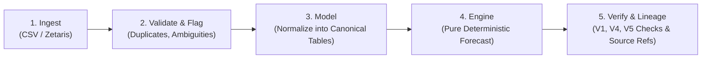
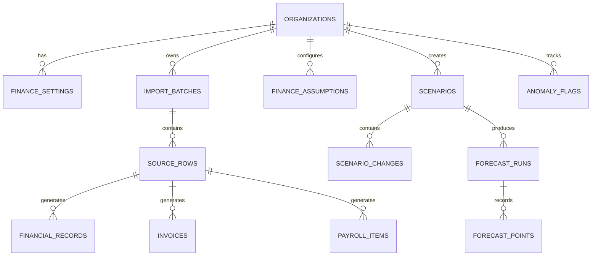
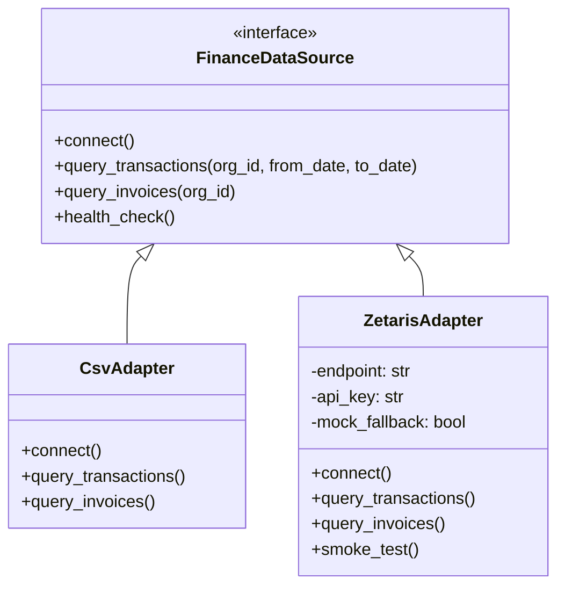

# 01. NeuralCFO Module Architecture & Technical Design
**Open Agent Hackathon 2026 · Master Specification v0.1 Implementation**  
**Author:** Sharjeel (Senior Backend / CFO Lead)  
**Status:** PROPOSED FOR APPROVAL (B1)  
**Dependencies:** Foundation Kit v1 (`foundation-v1`)

---

## 1. Module Structure (`services/api/app/cfo`)

The NeuralCFO module is strictly encapsulated within `services/api/app/cfo/`. It exposes public services only via `/packages/contracts` and `/v1/finance/*` HTTP endpoints.

```
services/api/app/cfo/
├── __init__.py
├── api/                         # FastAPI route handlers
│   ├── __init__.py
│   ├── routes.py                # /v1/finance/* endpoints
│   └── dependencies.py          # Route dependencies
├── services/                    # Business service orchestration
│   ├── __init__.py
│   ├── finance_service.py       # Implements FinanceService (contract tools)
│   ├── snapshot_service.py      # Implements CfoSnapshotService (Moonshot seam)
│   ├── baseline_service.py      # Immutable baseline generation & hashing
│   └── import_service.py        # CSV import orchestration & quality reporting
├── engine/                      # Pure deterministic calculation engine (NO LLM, NO I/O)
│   ├── __init__.py              # Engine version definition (0.1.0)
│   ├── calculator.py            # Cash flow accumulation: C(t) = C(t-1) + I(t) - O(t)
│   ├── bucketer.py              # ISO Monday weekly calendar bucketing
│   ├── runway.py                # Runway weeks derivation from forecast schedule
│   ├── levers.py                # Lever registry (hire, delay, revenue, deposit, etc.)
│   ├── cases.py                 # 3-case generator (expected, best, worst)
│   └── reserve.py               # Reserve amount & cash-floor-weeks conversion & breach checks
├── adapters/                    # External data source abstraction
│   ├── __init__.py
│   ├── base.py                  # FinanceDataSource abstract interface
│   ├── csv_adapter.py           # Standard CSV data loader
│   └── zetaris_adapter.py       # Sponsor adapter with real query path + mock fallback
├── importers/                   # Ingestion, validation & ambiguity detection
│   ├── __init__.py
│   ├── csv_importer.py          # Multipart CSV stream parser & content hashing
│   ├── column_mapper.py         # Ambiguity detection heuristic (e.g. date collisions)
│   └── validator.py             # Number/date parsing, anomaly & duplicate flagging
├── verification/                # Rules-based verification pipeline
│   ├── __init__.py
│   ├── verifier.py              # V1 Numbers, V4 Scenarios, V5 Units checks
│   └── lineage.py               # Formula & source-row resolver
├── models/                      # SQLAlchemy models for the 12 CFO tables
│   ├── __init__.py
│   └── cfo_models.py
└── schemas/                     # Pydantic internal schemas
    ├── __init__.py
    ├── imports.py               # Import batch request/response & quality reports
    ├── metrics.py               # Financial metrics & drivers
    └── lineage.py               # Lineage & claim details
```

---

## 2. End-to-End Data Flow

The data path follows a strict five-stage pipeline:



1. **Ingest (`importers/`):** Stream CSV or query `FinanceDataSource`. Store 100% of raw input in `source_rows` as JSONB alongside row index and SHA-256 file hash.
2. **Validate & Flag (`importers/validator.py`):** Identify column ambiguities, missing values, bad date formats, and duplicate invoice IDs. Reject corrupt rows with explicit error codes; flag duplicates in `anomaly_flags` without deletion.
3. **Model (`models/`):** Normalize validated rows into typed canonical tables: `financial_records` (actual transactions), `invoices` (receivables and payables), `payroll_items`, and `finance_assumptions`.
4. **Engine (`engine/`):** Pure deterministic function taking opening cash and weekly schedules. Calculates baseline points and applies scenario deltas across `expected`, `best`, and `worst` cases.
5. **Verify & Lineage (`verification/`):** Enforce V1 (numbers traceable to tool results), V4 (identical baseline, only declared levers applied), and V5 (currency/sign/date consistency). Attach source-row references and register lineage resolvers.

---

## 3. The 12 CFO Tables (Migration `0100_cfo_tables.py`)

All 12 tables reside in PostgreSQL, enforce `org_id UUID NOT NULL REFERENCES organizations(id)`, have indexes starting with `org_id`, and use `NUMERIC(18,2)` with `CHAR(3)` currency codes.



### Table Definitions & Constraints

#### 1. `finance_settings`
- `id UUID PK`, `org_id UUID NOT NULL REFERENCES organizations(id) UNIQUE`
- `reserve_amount NUMERIC(18,2) NOT NULL DEFAULT 50000.00`
- `cash_floor_weeks INT NOT NULL DEFAULT 12`
- `worst_case_delay_days INT NOT NULL DEFAULT 14`
- `worst_case_rev_pct_delta NUMERIC(5,2) NOT NULL DEFAULT -10.00`
- `best_case_advance_days INT NOT NULL DEFAULT 7`
- `best_case_rev_pct_delta NUMERIC(5,2) NOT NULL DEFAULT 5.00`
- `currency CHAR(3) NOT NULL DEFAULT 'USD'`
- `updated_at TIMESTAMPTZ NOT NULL DEFAULT CURRENT_TIMESTAMP`

#### 2. `import_batches`
- `id UUID PK`, `org_id UUID NOT NULL REFERENCES organizations(id)`
- `filename VARCHAR(255) NOT NULL`, `content_hash VARCHAR(64) NOT NULL`
- `status VARCHAR(50) NOT NULL CHECK (status IN ('pending', 'needs_mapping', 'processing', 'completed', 'failed'))`
- `total_rows INT NOT NULL DEFAULT 0`, `accepted_rows INT NOT NULL DEFAULT 0`, `rejected_rows INT NOT NULL DEFAULT 0`, `flagged_rows INT NOT NULL DEFAULT 0`
- `column_mapping JSONB NOT NULL DEFAULT '{}'`
- `quality_report JSONB NOT NULL DEFAULT '{}'`
- `created_at TIMESTAMPTZ NOT NULL DEFAULT CURRENT_TIMESTAMP`
- `UNIQUE(org_id, content_hash)` — Idempotency invariant

#### 3. `source_rows`
- `id UUID PK`, `org_id UUID NOT NULL REFERENCES organizations(id)`
- `batch_id UUID NOT NULL REFERENCES import_batches(id) ON DELETE CASCADE`
- `row_number INT NOT NULL`
- `raw_payload JSONB NOT NULL` — Verbatim raw CSV / source record
- `created_at TIMESTAMPTZ NOT NULL DEFAULT CURRENT_TIMESTAMP`
- `INDEX idx_source_rows_org_batch (org_id, batch_id)`

#### 4. `financial_records` (Actuals)
- `id UUID PK`, `org_id UUID NOT NULL REFERENCES organizations(id)`
- `source_row_id UUID REFERENCES source_rows(id) ON DELETE SET NULL`
- `transaction_date DATE NOT NULL`
- `amount NUMERIC(18,2) NOT NULL` (positive = inflow, negative = outflow)
- `currency CHAR(3) NOT NULL DEFAULT 'USD'`
- `category VARCHAR(100) NOT NULL` (revenue, payroll, rent, software, tax, etc.)
- `client_or_vendor VARCHAR(255)`
- `is_actual BOOLEAN NOT NULL DEFAULT TRUE`
- `INDEX idx_financial_records_org_date (org_id, transaction_date)`

#### 5. `invoices` (Receivables & Payables)
- `id UUID PK`, `org_id UUID NOT NULL REFERENCES organizations(id)`
- `source_row_id UUID REFERENCES source_rows(id) ON DELETE SET NULL`
- `invoice_number VARCHAR(100) NOT NULL`
- `kind VARCHAR(20) NOT NULL CHECK (kind IN ('receivable', 'payable'))`
- `client_or_vendor VARCHAR(255) NOT NULL`
- `amount NUMERIC(18,2) NOT NULL`
- `currency CHAR(3) NOT NULL DEFAULT 'USD'`
- `issue_date DATE NOT NULL`
- `due_date DATE NOT NULL`
- `expected_payment_date DATE NOT NULL`
- `status VARCHAR(50) NOT NULL CHECK (status IN ('draft', 'issued', 'paid', 'late', 'disputed', 'written_off'))`
- `is_uncertain BOOLEAN NOT NULL DEFAULT FALSE`
- `INDEX idx_invoices_org_expected (org_id, expected_payment_date)`
- `UNIQUE(org_id, invoice_number)` — Duplicates flagged if re-encountered

#### 6. `payroll_items`
- `id UUID PK`, `org_id UUID NOT NULL REFERENCES organizations(id)`
- `source_row_id UUID REFERENCES source_rows(id) ON DELETE SET NULL`
- `employee_identifier VARCHAR(100) NOT NULL` (e.g. "EMP-001" or hashed name)
- `role_title VARCHAR(255) NOT NULL`
- `monthly_gross NUMERIC(18,2) NOT NULL`
- `benefits_and_taxes NUMERIC(18,2) NOT NULL DEFAULT 0.00`
- `currency CHAR(3) NOT NULL DEFAULT 'USD'`
- `pay_frequency VARCHAR(50) NOT NULL DEFAULT 'monthly' CHECK (pay_frequency IN ('weekly', 'biweekly', 'monthly'))`
- `start_date DATE NOT NULL`
- `end_date DATE`
- `INDEX idx_payroll_org (org_id)`

#### 7. `finance_assumptions`
- `id UUID PK`, `org_id UUID NOT NULL REFERENCES organizations(id)`
- `category VARCHAR(100) NOT NULL` (opening_cash, payroll_day, default_tax_rate, etc.)
- `key VARCHAR(100) NOT NULL`
- `value JSONB NOT NULL` (e.g. `{"amount": "185000.00", "currency": "USD"}`)
- `valid_from DATE NOT NULL`
- `valid_to DATE`
- `INDEX idx_finance_assumptions_org_key (org_id, key)`

#### 8. `scenarios`
- `id UUID PK`, `org_id UUID NOT NULL REFERENCES organizations(id)`
- `baseline_run_id UUID NOT NULL` (references `forecast_runs(id)`)
- `name VARCHAR(255) NOT NULL`
- `origin VARCHAR(50) NOT NULL CHECK (origin IN ('user', 'moonshot_card'))`
- `source_card_id UUID`
- `created_at TIMESTAMPTZ NOT NULL DEFAULT CURRENT_TIMESTAMP`
- `INDEX idx_scenarios_org (org_id)`

#### 9. `scenario_changes`
- `id UUID PK`, `org_id UUID NOT NULL REFERENCES organizations(id)`
- `scenario_id UUID NOT NULL REFERENCES scenarios(id) ON DELETE CASCADE`
- `lever VARCHAR(100) NOT NULL`
- `op VARCHAR(20) NOT NULL CHECK (op IN ('set', 'add', 'multiply'))`
- `value VARCHAR(100) NOT NULL`
- `start_date DATE`
- `params JSONB NOT NULL DEFAULT '{}'`
- `is_assumption BOOLEAN NOT NULL DEFAULT TRUE`
- `created_at TIMESTAMPTZ NOT NULL DEFAULT CURRENT_TIMESTAMP`
- `INDEX idx_scenario_changes_org_scen (org_id, scenario_id)`

#### 10. `forecast_runs`
- `id UUID PK`, `org_id UUID NOT NULL REFERENCES organizations(id)`
- `scenario_id UUID REFERENCES scenarios(id) ON DELETE CASCADE` — `NULL` for baseline runs
- `case_type VARCHAR(20) NOT NULL CHECK (case_type IN ('baseline', 'expected', 'best', 'worst'))`
- `engine_version VARCHAR(50) NOT NULL` (e.g. `0.1.0`)
- `horizon_weeks INT NOT NULL DEFAULT 26`
- `start_date DATE NOT NULL`
- `end_date DATE NOT NULL`
- `min_cash NUMERIC(18,2) NOT NULL`
- `min_cash_date DATE NOT NULL`
- `end_cash NUMERIC(18,2) NOT NULL`
- `runway_weeks INT` — `NULL` if cash never drops below 0
- `reserve_breach BOOLEAN NOT NULL DEFAULT FALSE`
- `cash_floor_breach BOOLEAN NOT NULL DEFAULT FALSE`
- `status VARCHAR(50) NOT NULL CHECK (status IN ('verified', 'warning', 'unverified', 'failed'))`
- `baseline_hash VARCHAR(64)` — SHA-256 verifying baseline immutability
- `created_at TIMESTAMPTZ NOT NULL DEFAULT CURRENT_TIMESTAMP`
- `INDEX idx_forecast_runs_org (org_id, created_at)`

#### 11. `forecast_points` (Weekly Canonical)
- `id UUID PK`, `org_id UUID NOT NULL REFERENCES organizations(id)`
- `run_id UUID NOT NULL REFERENCES forecast_runs(id) ON DELETE CASCADE`
- `week_number INT NOT NULL`
- `week_start DATE NOT NULL` (ISO Monday)
- `opening_cash NUMERIC(18,2) NOT NULL`
- `projected_inflows NUMERIC(18,2) NOT NULL`
- `projected_outflows NUMERIC(18,2) NOT NULL`
- `net_cash_flow NUMERIC(18,2) NOT NULL`
- `closing_cash NUMERIC(18,2) NOT NULL`
- `value_label VARCHAR(50) NOT NULL CHECK (value_label IN ('observed', 'calculated', 'estimated', 'hypothetical'))`
- `contributing_inflow_refs JSONB NOT NULL DEFAULT '[]'` (array of UUIDs)
- `contributing_outflow_refs JSONB NOT NULL DEFAULT '[]'` (array of UUIDs)
- `INDEX idx_forecast_points_run (run_id, week_number)`

#### 12. `anomaly_flags`
- `id UUID PK`, `org_id UUID NOT NULL REFERENCES organizations(id)`
- `source_row_id UUID REFERENCES source_rows(id) ON DELETE SET NULL`
- `entity_type VARCHAR(100) NOT NULL` (invoice, payroll, transaction)
- `entity_id UUID`
- `anomaly_type VARCHAR(100) NOT NULL` (duplicate_invoice, abnormal_spike, missing_date, negative_amount)
- `severity VARCHAR(50) NOT NULL CHECK (severity IN ('info', 'warning', 'critical'))`
- `details JSONB NOT NULL DEFAULT '{}'`
- `status VARCHAR(50) NOT NULL DEFAULT 'flagged' CHECK (status IN ('flagged', 'reviewed', 'resolved', 'ignored'))`
- `created_at TIMESTAMPTZ NOT NULL DEFAULT CURRENT_TIMESTAMP`
- `INDEX idx_anomaly_flags_org (org_id, status)`

---

## 4. Lineage & Traceability Design

Every displayed financial figure traces to an origin:
1. **Actual Transactions:** `financial_records.source_row_id -> source_rows.id`.
2. **Invoices / Receivables:** `invoices.source_row_id -> source_rows.id`.
3. **Weekly Forecast Points:** `forecast_points.contributing_inflow_refs` and `contributing_outflow_refs` store arrays of source invoice / payroll / record UUIDs.
4. **Lineage Endpoint (`GET /v1/finance/forecast-points/{id}/lineage`):**
   Returns:
   ```json
   {
     "point_id": "uuid",
     "week_start": "2026-11-02",
     "formula": "closing_cash = opening_cash + inflows - outflows",
     "inputs": {
       "opening_cash": "185000.00",
       "inflows": "45000.00",
       "outflows": "36000.00",
       "closing_cash": "194000.00"
     },
     "assumptions": [
       {"category": "opening_cash", "as_of": "2026-10-22", "amount": "185000.00"}
     ],
     "source_rows": [
       {"id": "uuid", "type": "invoice", "client": "Apex Corp", "amount": "45000.00"},
       {"id": "uuid", "type": "payroll", "amount": "36000.00"}
     ]
   }
   ```
5. **Evidence Target Resolvers:** Registered in `EvidenceRegistry` for `source_row`, `financial_record`, `forecast_run`, `forecast_point`, and `finance_assumption`.

---

## 5. Pure Deterministic Forecast Engine Algorithm

### Arithmetic Law
$$\text{Cash}(w) = \text{Cash}(w-1) + \text{Inflows}(w) - \text{Outflows}(w)$$
- For week $w=1$: $\text{Cash}(0) = \text{opening\_cash}$ from `finance_assumptions` validated on `valid_from`.
- Time step: $\Delta t = 1 \text{ week}$ (Monday to Sunday inclusive).

### Runway Scanner
$$\text{runway\_weeks} = \begin{cases} 
\min \{w \in [1, H] \mid \text{Cash}(w) < 0\}, & \text{if } \exists w \text{ such that } \text{Cash}(w) < 0 \\
\text{null}, & \text{otherwise}
\end{cases}$$
Extrapolation via average monthly burn rate is **strictly prohibited**.

### Dual Cash Floor Evaluation
- **Reserve Amount Breach:**
  $$\text{reserve\_breach} = \exists w \in [1, H] : \text{Cash}(w) < \text{reserve\_amount}$$
- **Cash Floor Weeks Breach:**
  $$\text{Average Weekly Committed Outflow} = \frac{1}{H} \sum_{w=1}^{H} \text{committed\_outflows}(w)$$
  $$\text{Converted Floor} = \text{cash\_floor\_weeks} \times \text{Average Weekly Committed Outflow}$$
  $$\text{cash\_floor\_breach} = \exists w \in [1, H] : \text{Cash}(w) < \text{Converted Floor}$$

---

## 6. Scenario Delta Transformations & MVP Levers

Scenarios **never rewrite history or mutate the baseline**. The engine clones baseline cash inflows/outflows into an in-memory weekly ledger and applies deltas:

1. **`hire` (`count`, `monthly_cost`, `start_date`):**
   - Injects recurring weekly salary outflow of $(\text{count} \times \text{monthly\_cost} \times 12) / 52$ for all weeks $w \ge \text{week}(\text{start\_date})$.
2. **`payment_delay` (`client` or `invoice`, `days`):**
   - Shifts the expected receivable collection date by $+ \text{days}$. Inflow moves from week $w_1$ to week $w_2$. Historical invoice records in DB remain untouched.
3. **`payment_terms_days` (`days`, `start_date`):**
   - Applies new collection terms to invoices issued after `start_date`.
4. **`deposit_pct` (`percent`, `start_date`):**
   - Splits upcoming project billings into an immediate upfront deposit percentage and a remainder upon completion.
5. **`revenue_change_pct` (`percent`, `start_date`):**
   - Multiplies projected variable inflows by $(1 + \text{percent}/100)$ for $w \ge \text{week}(\text{start\_date})$.
6. **`lost_client` (`client`, `date`):**
   - Sets future recurring inflows from specified client to $0$ from `date` onward.
7. **`price_change_pct` (`percent`, `start_date`, `scope`):**
   - Increases price across scoped future contracts.
8. **`expense_change` (`amount`, `cadence`, `start_date`):**
   - Adds or subtracts scheduled operating expenses.

---

## 7. Three-Case Generation Rules

Every scenario run executes three branches:
1. **`expected` Case:** Evaluates the explicit scenario parameters as supplied.
2. **`best` Case:**
   - Inflow acceleration: Invoices from uncertain clients advance by $-7$ days.
   - Revenue variance: Relative $+5.00$ percentage points applied to revenue change levers.
3. **`worst` Case:**
   - Inflow delay: Invoices from uncertain clients delay by $+14$ days.
   - Revenue variance: Relative $-10.00$ percentage points applied to revenue change levers.

All parameters are recorded in `forecast_runs.case_type` and rendered in the API response.

---

## 8. Adapter Architecture (`FinanceDataSource`)

To fulfill REQ-CFO-23 without guessing unannounced sponsor specs:



- If `ZETARIS_ENABLED=true` and credentials exist, `ZetarisAdapter` issues live network queries.
- If credentials are not present, `ZetarisAdapter` operates in explicit mock-fallback mode and logs diagnostics.
- Standalone smoke test `tests/cfo/test_zetaris_smoke.py` verifies both paths.

---

## 9. Risk Inventory & Mitigations

| Risk | Impact | Mitigation Strategy |
| :--- | :--- | :--- |
| **Floating-Point Drift** | Non-deterministic cash reconciliation | Enforce Python `decimal.Decimal` and SQL `NUMERIC(18,2)` throughout engine. Reject float casting in CI tests. |
| **Silent Import Loss** | Data omission silently alters baseline | Ingestion saves every row in `source_rows`. Duplicates and parsing issues are logged to `anomaly_flags` and `import_batches.quality_report`. |
| **Baseline Mutation** | Scenario corrupts baseline forecast | Baseline run is hashed (SHA-256). Property tests assert that baseline hash before scenario equals baseline hash after scenario. |
| **Cross-Tenant Data Leak** | Critical privacy violation | Every query filters on `org_id` derived exclusively from JWT `get_auth_context()`. Multi-tenant test suite runs in CI. |
| **Ambiguous CSV Formats** | Wrong dates or columns ingested | `ColumnMapper` detects ambiguous columns; pauses import in `needs_mapping` status until admin confirms column assignments. |

---

## 10. Approval Request

This design completely addresses sections 1, 5, 7.3, 7.5, 8, 11, 12, 13, 15, 16, and 17 of the Master Specification.  
**Senior Backend Engineer awaits confirmation to proceed with Vertical Slices 1–9.**
